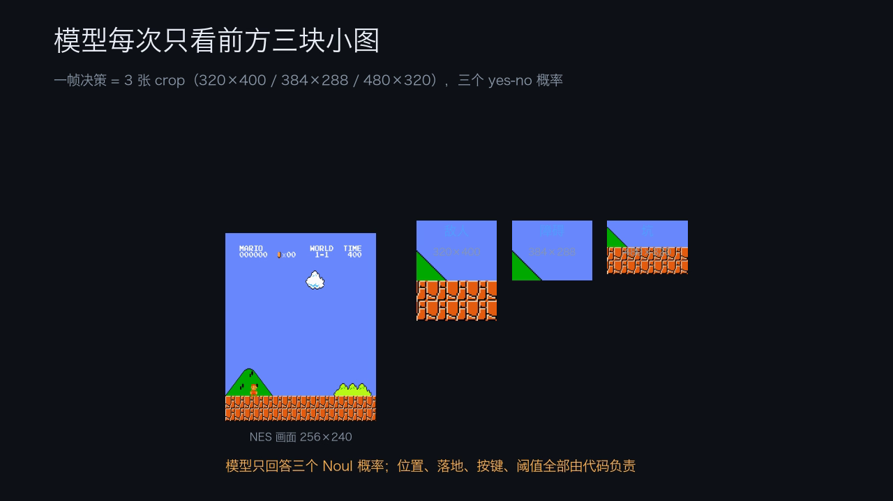

一台 16 GB 的 MacBook Air，没有独显、没有联网、没有 API key。屏幕上马里奥在跑。每隔两三秒，一个 9B 参数的模型被叫醒一次：看一眼前方三块裁剪图，回答"有敌人吗、有障碍吗、地板有坑吗"，然后把三个概率交给代码，代码决定跑还是跳。

<figure class="video-figure">
  <video autoplay muted loop playsinline preload="metadata" poster="/assets/mario-clef/hero-poster.png" aria-label="马里奥 demo 在 M2 Air 上用本机 Clef 模型连续跑动">
    <source src="/assets/mario-clef/hero.mp4" type="video/mp4">
  </video>
  <figcaption>M2 Air 上的实际回放（24 个决策、x=507）。画面按 NES 60 Hz 逐帧播放，每步之间那段停顿是模型在思考。M1 Pro 用同一套配方，参考组合约 2.2 s/请求。</figcaption>
</figure>

<div class="metric-strip">
  <div><strong>9B</strong><span>affine 4-bit backbone</span></div>
  <div><strong>3</strong><span>noul questions per step</span></div>
  <div><strong>0</strong><span>cloud requests</span></div>
  <div><strong>1</strong><span>command from zero</span></div>
</div>

## 一个会聊天的模型，在这里没用

马里奥不需要对话。它需要的是：给定一帧画面和三个是/否问题，给出三个概率。这是[决策模型](https://huggingface.co/mlx-community/clef-flash-4bit)的形状，不是聊天模型的形状。

Clef 把"状态 + 结构化问题"映射成每个候选答案的概率，一次前向出结果，不生成文本。它的 Metal 实现进到 demo 之后，整条链路都在本机：没有云端请求，没有密钥，三张裁剪图不出机器。

这也是为什么这件事值得认真做。云端 API 能回答同样的问题，但你付的是每次往返的网络延迟和 token 账单；本机决策模型付的是一次性的权重加载，和每次前向的几十上百毫秒。前者适合 demo 起步，后者才是一条可以反复跑、可以离线、可以塞进任何玩具里的路径。

## 模型真正看到的东西

每步只喂三块图：敌人（64×80）、障碍（64×48）、坑（96×64），最近邻整数倍放大到 320×400 / 384×288 / 480×320。默认 `separate` 协议一图一题一请求，三个问题各自只看自己的裁剪。

<figure>
  
  <figcaption>一帧决策 = 三张裁剪 + 三个概率。位置、是否落地、截图、阈值和按键全部由 Python 负责，模型不读 RAM、不规划路线。</figcaption>
</figure>

这一点很容易被忽略：模型的能力上界不是"能不能通关"，而是"这三张图里的三个问题答得准不准"。通关是代码逻辑、阈值和动作帧数的事。两者必须分开评估，否则你永远不知道是模型看错了，还是动作配方不行。

## 一条命令

在配套教程仓库根目录：

```sh
./scripts/mario_demo.sh
```

它把从零到页面之间的事情全部做完：检查机器、准备 MLX 0.32.3 SDK、构建决策服务（`--features coreml`，GPU 与 Neural Engine 在同一个二进制里）、从 ModelScope 下 6.2 GB 权重、建 demo 的 Python 环境、找空闲端口启动页面，然后打开浏览器。

```text
[1/6] 系统与工具         Apple M2（16 GB）
[2/6] MLX 0.32.3 SDK     复用 / 已安装
[3/6] apxinf-decide-server 构建或复用
[4/6] Clef 权重          ModelScope（失败回退 hf-mirror / 官方）
[5/6] demo Python 环境   gym-super-mario-bros 7.4.0
[6/6] 启动页面           READY http://127.0.0.1:8766
```

看到 `READY` 后，策略下拉选 `clef`、点**重开**、再点**单步**或**自动**。第一次点击要等权重加载和三个裁剪形状各自的首次编译，之后进入稳态。每一步都能在页面上看到三张裁剪、三个概率和这一决策的延迟；云端用量永远是 0。

## 三种芯片，三种组合

ApxInf 只在**通过资格验证**的架构上启用优化组合，其余芯片退回 reference（能跑，只是慢）。构建只有一种 `coreml`：

| 芯片 | `auto` 选中 | 依据 |
| --- | --- | --- |
| M1 Pro（`applegpu_g13s`） | GPU + ANE 列切分 | GPU 与列切分都过资格 |
| M2（`applegpu_g14g`） | GPU 组合 | 2026-11-15 起纳入；demo 裁剪 parity max abs(Δp) 0.0024（gate 0.035） |
| M4（`applegpu_g16g`） | GPU + ANE 神经元切分 | 加载 93–130 s 量级，稳态更快 |
| 普通 M1 / M3 | reference | 能跑，只是慢 |

顺带说一句：M2 之前一直落在 reference 上，慢到不适合演示。这次把它的 GPU 组合纳入资格列表后，同一台机器从"能跑通"变成"能看"。

## 数字

M2 Air（16 GB、8 核）在参考组合与 GPU 组合下的对照：

| 项 | reference（未资格时） | GPU 组合（现在） |
| --- | --- | --- |
| 加载 `load_ms` | 16.2 s | 16.7 s（同机记录） |
| 单个冷请求 | 66.6 s | 秒级（低内存压力窗口） |
| 一局 | 1 决策 383 s（换页窗口） | `single` 协议 39 决策到旗杆，中位 2.99 s/决策，整局 120.9 s |
| 云端请求 | 0 | 0 |

M1 Pro 的历史记录：reference 组合约 2.2 s/请求、6.6 s/决策。M4 的 ANE 组合加载在 93–130 s，换来更快的稳态。三组数字不能直接互相比较——芯片、组合、内存压力和协议都不同。

权重下载速度（同一网络、20 MB 文件）：

<div class="bars">
  <div class="bar-row"><span>ModelScope</span><div class="bar"><i style="width:100%"></i></div><b>4.3 MB/s</b></div>
  <div class="bar-row"><span>hf-mirror</span><div class="bar"><i style="width:2%"></i></div><b>90 KB/s</b></div>
  <div class="bar-row"><span>官方 HF</span><div class="bar"><i style="width:2.2%"></i></div><b>96 KB/s</b></div>
</div>

差一个数量级。所以脚本默认走 ModelScope，失败才回退镜像和官方 Hub。

## 三个只有真跑才会撞到的坑

<div class="callout">
<strong>1 · 二进制没有 rpath，必须带 DYLD_LIBRARY_PATH</strong>
漏了会得到 <code>dyld: Library not loaded: @rpath/libmlx.dylib … no LC_RPATH's found</code>。这是 dyld 错误，不是模型或权重问题，第一次遇到很容易往错的方向查。
</div>

<div class="callout">
<strong>2 · demo 目录只读时，账本会先炸</strong>
启动快照会读写云端账本，默认落在 demo 目录的 <code>devlocal/</code>。目录不可写时抛 <code>PermissionError: [Errno 1] Operation not permitted</code>，而且不是可读提示。设 <code>MARIO_API_LEDGER</code> 到可写位置即可——本地 <code>clef</code> 策略本身不往这个账本记账。
</div>

<div class="callout">
<strong>3 · 16 GB 是下限，不是舒适区</strong>
Clef 4-bit 峰值 7.0–8.6 GB。系统已有几个大应用时，机器进入换页主导状态：加载 16 s，单个请求却能到 66 s 甚至两分钟。你测到的不是模型速度，是内存压力。
</div>

## 自己动手

不用脚本时的核心步骤（在 ApxInf 源码目录内）：

```sh
export MLX_ROOT="$HOME/.local/share/apxinf-mlx-sdk/lib/python3.11/site-packages/mlx"
export DYLD_LIBRARY_PATH="$MLX_ROOT/lib"
cargo build --release --locked --features coreml --bin apxinf-decide-server
```

```sh
export APXINF_DECIDE_CMD="$PWD/target/release/apxinf-decide-server \
  --model $HOME/models/clef-flash-4bit --model-variant auto"
export MARIO_CLEF_PROTOCOL=separate
export APXINF_LOAD_TIMEOUT=900 APXINF_DECIDE_TIMEOUT=900
devlocal/mario-demo/.venv/bin/python examples/mario_demo/server.py --port 8766
```

离线跑一局（不打开页面）：

```sh
devlocal/mario-demo/.venv/bin/python examples/mario_demo/evaluate.py \
  --policy clef --max-decisions 12 --out devlocal/mario-demo/clef-12
```

## 边界

- 12 个决策全是负例时，混淆矩阵会是全 TN、准确率 1.0。这只说明这些帧上没有误报，不是识别能力，也不是通关结论。
- 换协议（`separate` / `joint` / `single`）、换阈值、换动作帧数，都要重新跑基线；不同配方的数字不要混着比。
- 数值对齐由 ApxInf 仓库自己的测试负责。这篇文章里的数字只证明这条链路在这些机器上跑通、可复现。

**归属**：决策服务与 Metal 后端来自 [ApxInf](https://github.com/infinigence/ApxInf)；模型是 [mlx-community/clef-flash-4bit](https://huggingface.co/mlx-community/clef-flash-4bit)（基座 [Cloudflare/clef-flash](https://huggingface.co/Cloudflare/clef-flash)，Apache-2.0），[ModelScope](https://modelscope.cn/models/mlx-community/clef-flash-4bit) 上有同 id 镜像；Mario demo 的裁剪、问题、阈值与宏动作移植自 [FluidUse](https://github.com/FluidInference/FluidUse) 的 JevMarioDemo（Apache-2.0）。
